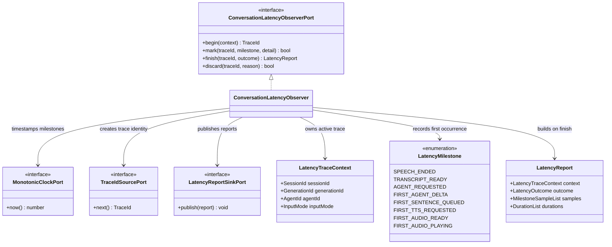

# Conversation latency observer class boundary

`ConversationLatencyObserver` applies the Observer pattern. Voice objects emit
typed milestones without knowing how measurements are stored or displayed.
The observer uses one injected monotonic clock, derives durations when a trace
closes, and sends the immutable report to an injected sink.

