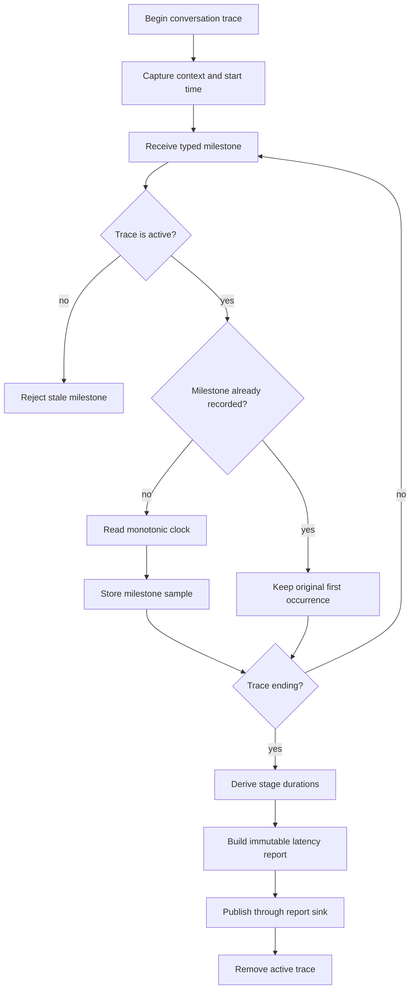

# Latency trace flow

Every conversation turn receives an independent trace. A milestone is recorded
only for a live trace and only once, so retries and repeated stream chunks do
not change the first occurrence measurements. Finishing, interruption, and
failure all close the trace and publish a report.

The first report should expose these actionable intervals:

- speech ended to transcript ready;
- agent request to first assistant delta;
- first assistant delta to first complete sentence;
- first TTS request to audio ready;
- audio ready to playback start; and
- speech ended or agent request to first audible reply.

