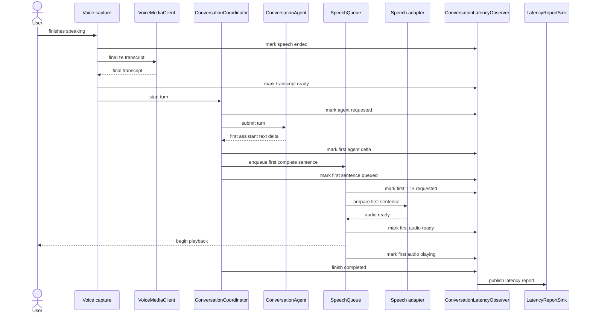

# Measuring the first audible reply

The observer receives milestones from existing objects. It does not start an
agent request, synthesize speech, play audio, or update the UI. This keeps
instrumentation separate from conversation behavior.

